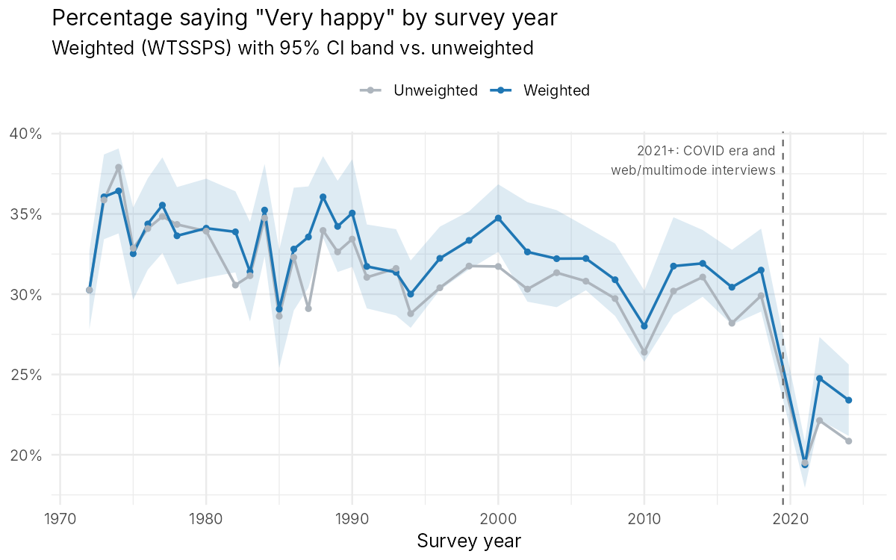
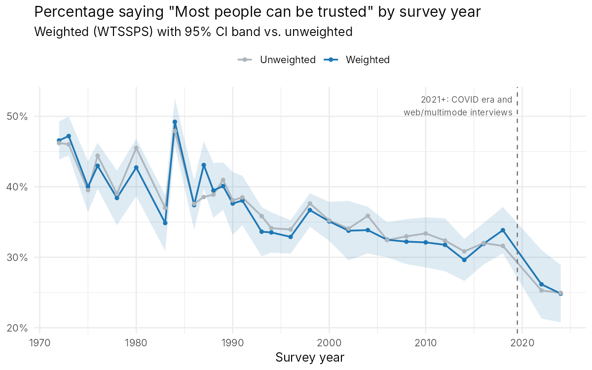
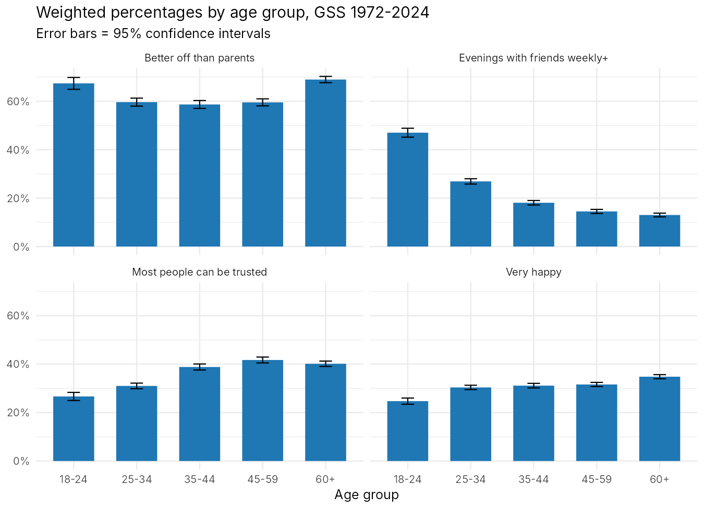
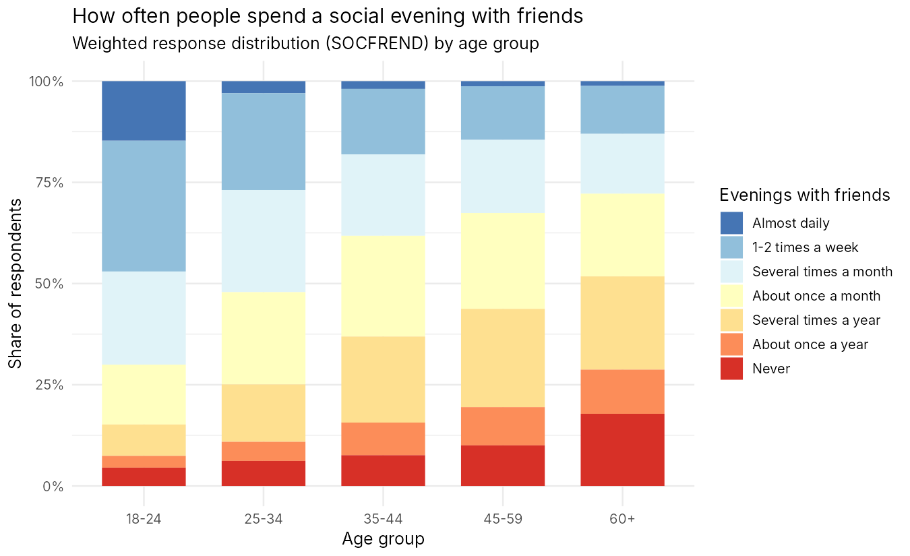
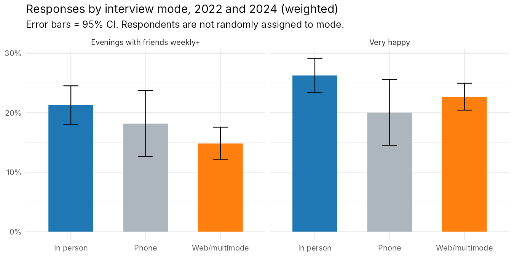
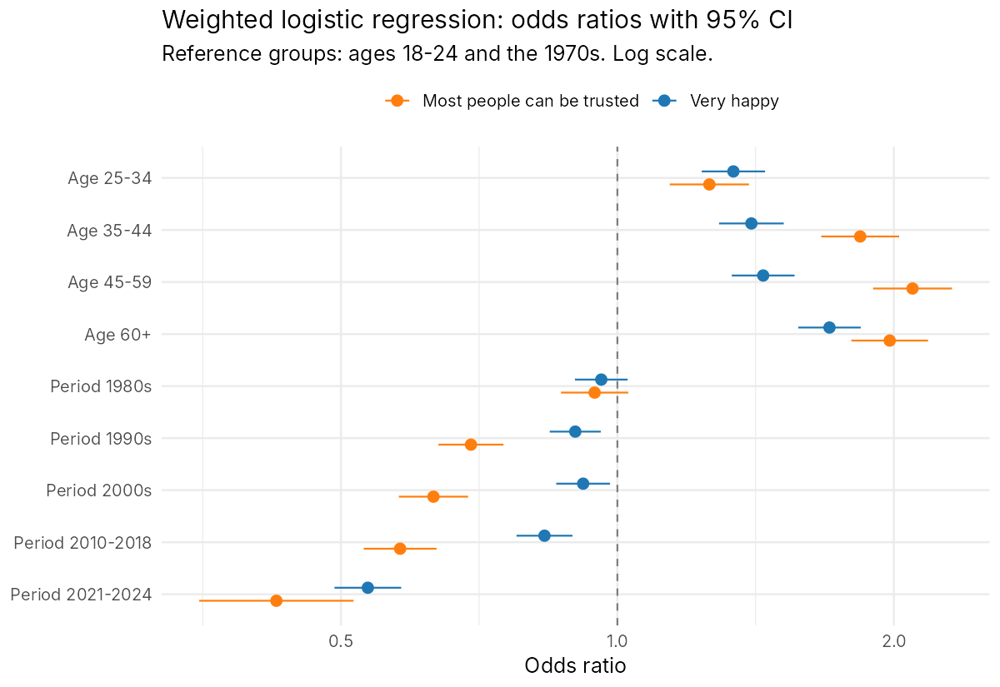

```{r setup, include = FALSE}
knitr::opts_chunk$set(echo = TRUE, message = FALSE, warning = FALSE, fig.align = "center")
library(DBI)
library(RSQLite)
library(dplyr)
library(knitr)

# This report uses the outputs of the three scripts in R/ (run them first).
con <- dbConnect(SQLite(), "data/gss.sqlite")

trend    <- read.csv("output/trend_weighted_vs_unweighted.csv")
age_tbl  <- read.csv("output/age_group_weighted.csv")
mode_tbl <- read.csv("output/mode_2022_2024_weighted.csv")
or_all   <- read.csv("output/logistic_odds_ratios.csv")

# small helpers for inline numbers
tr <- function(ind, yr, tp = "Weighted") round(trend$pct[trend$indicator == ind & trend$year == yr & trend$type == tp], 1)
ag <- function(ind, grp) round(age_tbl$pct[age_tbl$indicator == ind & age_tbl$age_group == grp], 1)
or <- function(out, term) round(or_all$odds_ratio[or_all$outcome == out & or_all$term == term], 2)
md <- function(ind, m) round(mode_tbl$pct[mode_tbl$indicator == ind & mode_tbl$mode_label == m], 1)
```

# Introduction

This project uses the General Social Survey (GSS) to examine friendship, emotions,
sociability, social mobility and social trust among U.S. adults. It asks two questions:

1. How have responses changed across survey years?
2. How do responses differ across age groups?

This version extends my earlier unweighted analysis in four ways: (1) the summaries are
built in **SQL**, (2) estimates use the **GSS survey weights** with 95% confidence
intervals, (3) the 2021–2024 **change in interview mode** is checked, and (4) simple
**logistic regressions** separate age differences from period differences.

The analysis is descriptive: it shows patterns, not causes.

# Data

* **Source:** GSS 1972–2024 cumulative file (NORC at the University of Chicago), read
  either from the official Stata file or from the `gssr` R package (`R/01_prepare_data.R`).
* **Sample:** 75,699 respondents across 35 survey years.
* **Weights:** `WTSSPS` (post-stratification weight recommended by NORC for the cumulative
  file), with `VPSU` and `VSTRAT` describing the clustered sample design.

## Variables

| Theme | Variable | Question | Scale | Indicator used |
|---|---|---|---|---|
| Feelings | HAPPY | General happiness | 1 = very happy … 3 = not too happy | % very happy |
| Friendship | SOCFREND | Social evenings with friends | 1 = almost daily … 7 = never | % at least weekly (codes 1–2) |
| Sociability | SOCBAR | Going to a bar or tavern | 1 = almost daily … 7 = never | mean code |
| Social mobility | PARSOL | Living standard vs. parents at same age | 1 = much better … 5 = much worse | % better (codes 1–2) |
| Trust | TRUST | Can most people be trusted? | 1 = can trust, 2 = can't be too careful, 3 = depends | % can trust |

Because the items are **ordinal**, the main results use percentages of clearly defined
categories and full response distributions rather than means of the codes.

## Check: the data reproduce my original numbers

```{sql, connection = con}
SELECT year,
       ROUND(100.0 * AVG(very_happy), 1)     AS pct_very_happy,
       ROUND(100.0 * AVG(people_trusted), 1) AS pct_trust
FROM gss
WHERE year IN (1972, 2024)
GROUP BY year
```

These unweighted values (30.3% → 20.8% very happy; 46.2% → 24.9% trust) match my
original report.

# SQL summaries

All unweighted summaries are produced by `sql/queries.sql`. Two examples:

**Year coverage.** Not every question was asked every year. `AVG()` ignores `NULL`, so
years without a question show as missing, not zero.

```{sql, connection = con, max.print = 12}
SELECT year,
       COUNT(happy)    AS happy_n,
       COUNT(trust)    AS trust_n,
       COUNT(socfrend) AS socfrend_n,
       COUNT(parsol)   AS parsol_n
FROM gss
GROUP BY year
ORDER BY year DESC
```

**Change between periods** using a CTE and the `LAG()` window function:

```{sql, connection = con}
WITH by_period AS (
  SELECT period, MIN(year) AS first_year,
         ROUND(100.0 * AVG(very_happy), 1)     AS pct_very_happy,
         ROUND(100.0 * AVG(people_trusted), 1) AS pct_trust
  FROM gss GROUP BY period
)
SELECT period, pct_very_happy,
       ROUND(pct_very_happy - LAG(pct_very_happy) OVER (ORDER BY first_year), 1) AS change_happy,
       pct_trust,
       ROUND(pct_trust - LAG(pct_trust) OVER (ORDER BY first_year), 1)           AS change_trust
FROM by_period ORDER BY first_year
```

# Weighted estimates

The weighted estimates come from the `survey` package:

```{r design, eval = FALSE}
des <- svydesign(ids = ~vpsu, strata = ~vstrat, weights = ~wtssps,
                 nest = TRUE, data = gss)
svyby(~very_happy, ~year, subset(des, !is.na(very_happy)), svymean, na.rm = TRUE)
```

## Happiness over time

```{r, echo = FALSE, out.width = "85%"}

```

* From 1972 to 2018, the weighted share saying "very happy" moved within roughly a
  28–37% band: `r tr("Very happy", 1972)`% in 1972 and `r tr("Very happy", 2018)`% in 2018.
* It then dropped to `r tr("Very happy", 2021)`% in 2021 and was `r tr("Very happy", 2024)`%
  in 2024. **Most of the long-run decline happens at the 2021 break**, which coincides with
  both the COVID-19 pandemic and the switch to web/multimode interviewing.
* Weighting matters more in recent years: in 2024 the weighted estimate is
  `r tr("Very happy", 2024)`% versus `r tr("Very happy", 2024, "Unweighted")`% unweighted.

## Social trust over time

```{r, echo = FALSE, out.width = "85%"}

```

* Trust declined steadily **before** the mode change: from `r tr("Most people can be trusted", 1972)`%
  in 1972 to `r tr("Most people can be trusted", 2018)`% in 2018, and was
  `r tr("Most people can be trusted", 2024)`% in 2024.
* TRUST was not asked in 2021, and in 2022 and 2024 it was asked almost entirely in person or
  by phone (only 65 web answers), so the recent low values are not a web-mode artifact.

```{sql, connection = con}
SELECT year, mode_label, COUNT(trust) AS trust_answers, COUNT(happy) AS happy_answers
FROM gss
WHERE year >= 2021
GROUP BY year, mode_label
ORDER BY year, mode_label
```

## Differences by age group

```{r, echo = FALSE, out.width = "90%"}

```

```{r}
age_tbl |>
  mutate(estimate = sprintf("%.1f%% (%.1f–%.1f)", pct, ci_low, ci_high)) |>
  select(indicator, age_group, estimate) |>
  tidyr::pivot_wider(names_from = age_group, values_from = estimate) |>
  kable(caption = "Weighted percentages by age group, with 95% CIs")
```

* **Friendship:** `r ag("Evenings with friends weekly+", "18-24")`% of 18–24-year-olds spend an
  evening with friends at least weekly, compared with `r ag("Evenings with friends weekly+", "60+")`%
  of those 60+.
* **Happiness and trust are higher among older adults:** "very happy" goes from `r ag("Very happy", "18-24")`%
  (18–24) to `r ag("Very happy", "60+")`% (60+); trust peaks at `r ag("Most people can be trusted", "45-59")`%
  among 45–59-year-olds.
* **Mobility is U-shaped:** `r ag("Better off than parents", "18-24")`% of 18–24 and
  `r ag("Better off than parents", "60+")`% of 60+ say they are better off than their parents,
  versus `r ag("Better off than parents", "35-44")`% of 35–44.

### Full response distribution (ordinal data)

```{r, echo = FALSE, out.width = "90%"}

```

The stacked bars show the whole SOCFREND scale rather than one mean: the share answering
"never" grows steadily with age, while "almost daily" is common only among 18–24-year-olds.

### Happiness trends within each age group

```{r, echo = FALSE, out.width = "100%"}

```

The 2021 drop appears in **every** age group, which fits a period-wide change (pandemic
and/or survey mode) better than a change affecting one generation.

# Survey-mode check (2022 and 2024)

In 2022 and 2024, respondents were interviewed in person, by phone or on the web.

```{r, echo = FALSE, out.width = "85%"}

```

```{r}
or_all |>
  filter(outcome == "Very happy (2022-2024, mode model)", grepl("mode", term)) |>
  transmute(term, odds_ratio = round(odds_ratio, 2),
            ci = sprintf("%.2f–%.2f", or_low, or_high), p_value = signif(p_value, 2)) |>
  kable(caption = "Very happy ~ mode + age group + year (reference: in person)")
```

* Web/multimode respondents were less likely to say "very happy" (`r md("Very happy", "Web/multimode")`%
  vs. `r md("Very happy", "In person")`% in person). After adjusting for age group and year, the
  odds ratio for web is `r or("Very happy (2022-2024, mode model)", "mode_labelWeb/multimode")`.
* Respondents choose their mode, so this is **not** a clean experiment, but it suggests that
  part of the post-2021 drop in happiness may reflect *how* the question was asked.

# Logistic regression: age vs. period

```{r models, eval = FALSE}
svyglm(very_happy ~ age_group + period, design = des, family = quasibinomial())
svyglm(people_trusted ~ age_group + period, design = des, family = quasibinomial())
```

```{r, echo = FALSE, out.width = "85%"}

```

```{r}
or_all |>
  filter(outcome %in% c("Very happy", "Most people can be trusted"), term != "(Intercept)") |>
  transmute(outcome, term, odds_ratio = round(odds_ratio, 2),
            ci = sprintf("%.2f–%.2f", or_low, or_high), p_value = signif(p_value, 2)) |>
  kable(caption = "Odds ratios (reference: ages 18–24, 1970s)")
```

How to read this: an odds ratio above 1 means higher odds than the reference group,
holding the other variable constant.

* **Age:** compared with 18–24-year-olds in the same period, people 60+ have
  `r or("Very happy", "age_group60+")` times the odds of being very happy and 45–59-year-olds
  have `r or("Most people can be trusted", "age_group45-59")` times the odds of saying most
  people can be trusted.
* **Period, happiness:** odds stay within about 10% of the 1970s level through the 2000s
  (OR = `r or("Very happy", "period1990s")`–`r or("Very happy", "period1980s")`), dip modestly in
  2010–2018 (OR = `r or("Very happy", "period2010-2018")`), then fall sharply in 2021–2024
  (OR = `r or("Very happy", "period2021-2024")`).
* **Period, trust:** the decline starts earlier. The odds are already lower in the 1990s
  (OR = `r or("Most people can be trusted", "period1990s")`) and keep falling to
  `r or("Most people can be trusted", "period2021-2024")` in 2021–2024.

# Main findings

1. **Happiness was fairly stable for 45 years, then dropped in 2021.** The weighted share
   "very happy" was `r tr("Very happy", 1972)`% in 1972 and `r tr("Very happy", 2018)`% in 2018,
   then `r tr("Very happy", 2024)`% in 2024. The break coincides with COVID-19 and a change in
   survey mode, and web respondents report lower happiness.
2. **Trust has been declining for decades**, from `r tr("Most people can be trusted", 1972)`% to
   `r tr("Most people can be trusted", 2024)`%, and the recent values come mostly from in-person
   interviews.
3. **Younger adults socialize with friends much more often but are less happy and less trusting**
   than older adults, and these age gaps remain after controlling for survey period.
4. **Most adults in every age group feel better off than their parents**, with a U-shaped
   pattern across age groups.

# Limitations

* **Age, period and cohort are mixed together.** Repeated cross-sections cannot fully
  separate getting older from being born in a different generation.
* **Mode and pandemic effects overlap** in 2021–2024 and cannot be fully separated.
* **Items are not asked every year** (e.g., TRUST not in 2021, PARSOL only from 1994).
* Ordinal answers were simplified into yes/no indicators for the regressions.

# Next steps

* Add birth cohort to the models to explore age–period–cohort patterns.
* Use ordinal (proportional-odds) regression to keep the full response scales.
* Compare with other national surveys that did not change mode in 2021.

# Source

Davern, M., Bautista, R., Freese, J., Herd, P., & Morgan, S. L. General Social Survey
1972–2024 [Data set]. NORC at the University of Chicago. Accessed via the `gssr` R package
(Healy, K.).

```{r cleanup, include = FALSE}
dbDisconnect(con)
```
